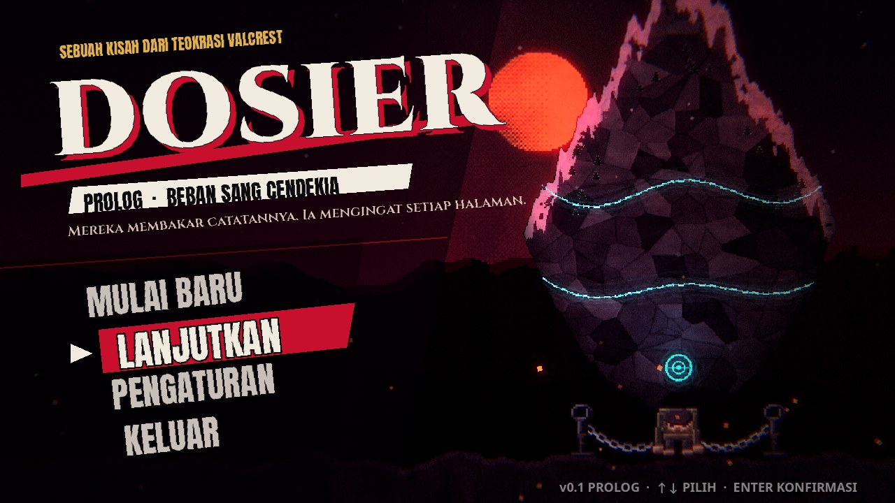
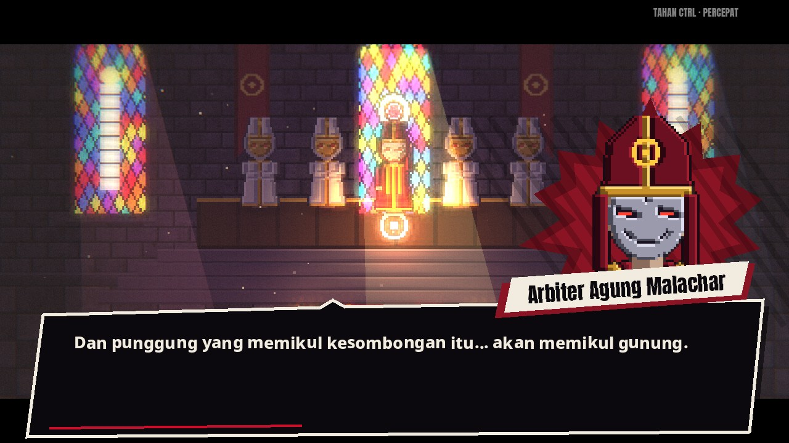
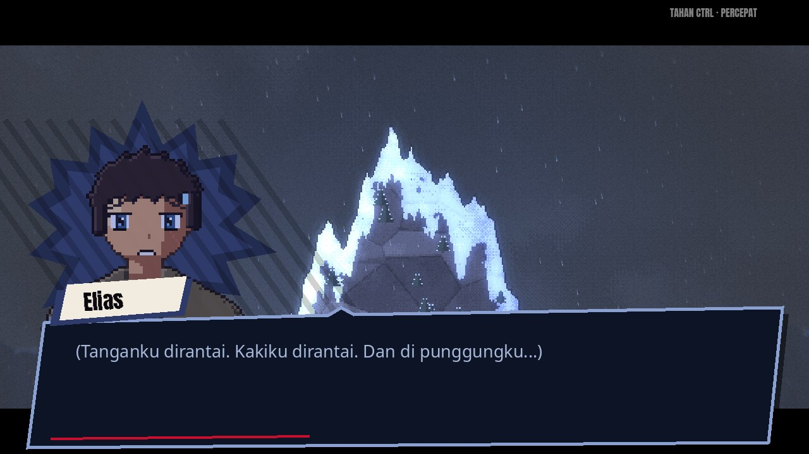
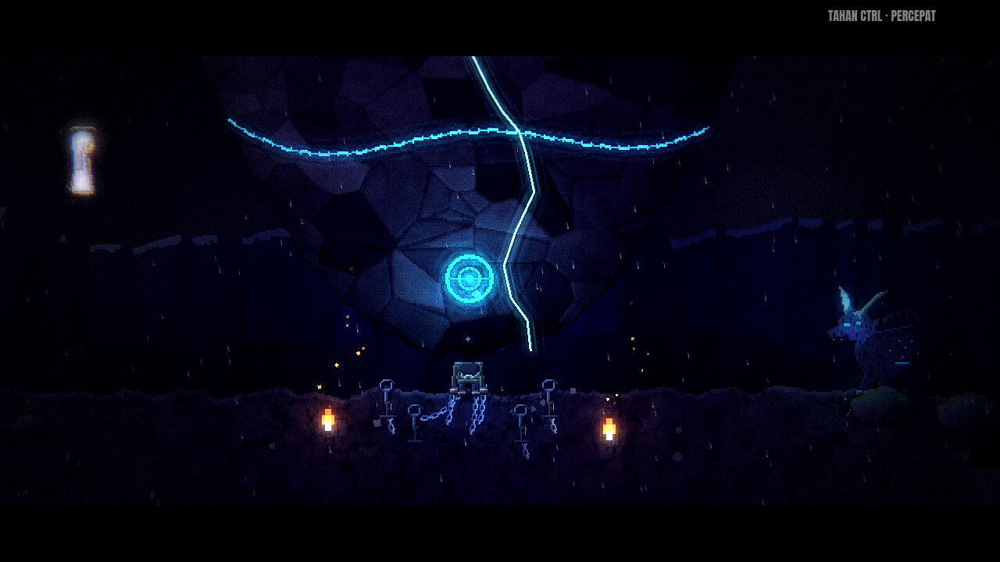
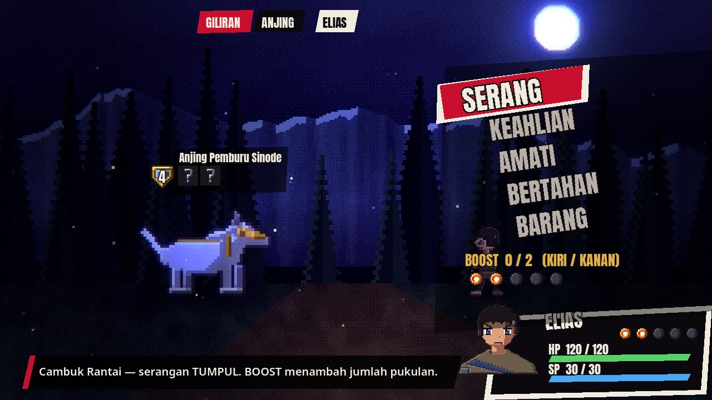
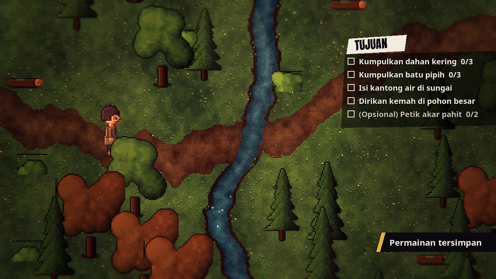
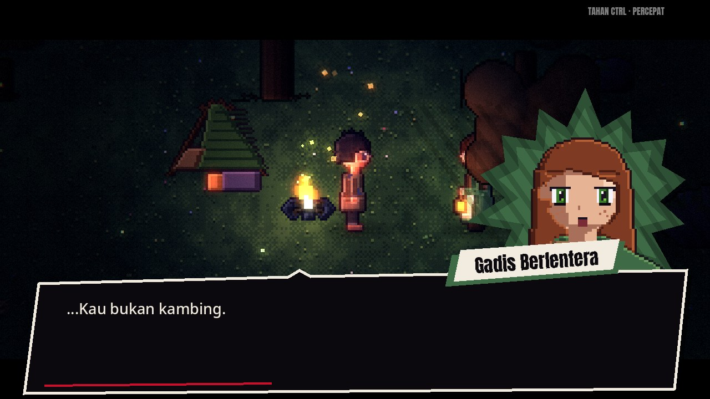
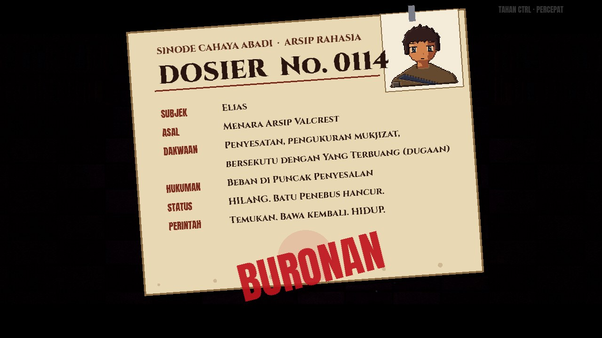
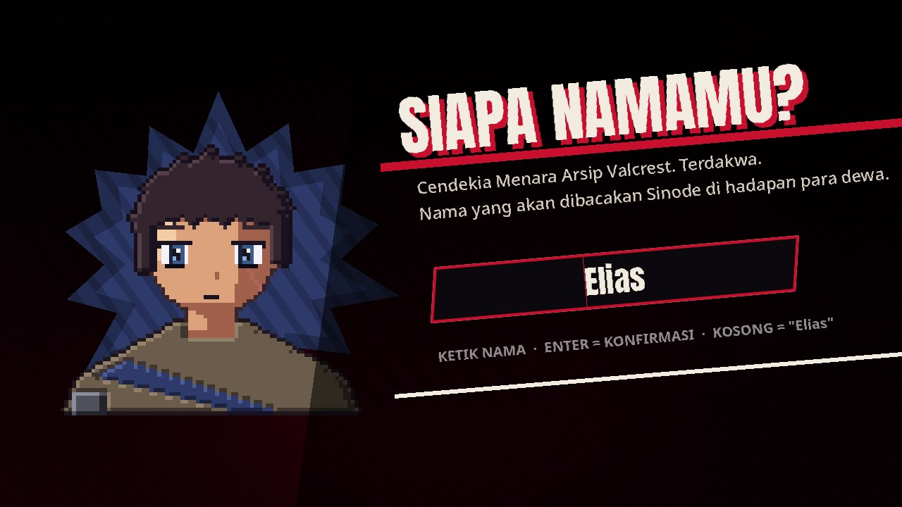

# DOSIER

**Prolog: Beban Sang Cendekia.** Sebuah RPG pixel art turn-based dengan pencahayaan bergaya
HD-2D (terinspirasi *Octopath Traveler*) dan antarmuka bergaya *Persona*. Genre utamanya
dark fantasy dan fantasy abad pertengahan, dengan romance porsi sedang, thriller, serta komedi
remaja yang segar.

> *Mereka membakar catatannya. Ia mengingat setiap halaman.*

Seorang cendekia Menara Arsip (nama ditentukan pemain) dituduh sesat oleh Dewan Sinode. Tangan
dan kakinya dirantai, dan punggungnya dipaksa memikul batu sebesar gunung. Seratus empat belas
hari kemudian, pertarungan antara **Yang Terbuang** dan **Santa Ilvaine** membuat tombak-tombak
cahaya meleset dan memutus rantainya. Ia tidak punya sihir, hanya otak dan kemampuan bertahan
hidup. Ia menghancurkan batu itu, kabur ke tepi desa terpencil, lalu mendirikan kemah sementara.



| | |
|---|---|
|  |  |
|  |  |
|  |  |
|  |  |

## Menjalankan

1. Instal **Godot 4.7** (diuji dengan **4.7.2-stable**, versi stabil terbaru saat proyek dibuat).
2. Buka Godot, pilih **Import**, lalu arahkan ke `project.godot` di folder ini.
3. Tunggu impor aset selesai, lalu tekan **F5**.

Proyek memakai renderer **Compatibility** (OpenGL 3.3/ES 3) agar ringan dan berjalan di hampir
semua PC/laptop. Seluruh efek (tilt-shift, bloom, color grading, cahaya 2D dengan *normal map*)
bekerja di renderer ini.

## Kontrol

| Aksi | Keyboard | Gamepad |
|---|---|---|
| Bergerak / pilih menu | Panah / WASD | D-pad / stik kiri |
| Konfirmasi / interaksi / lanjut dialog | Enter, Spasi, Z, E (atau klik kiri untuk dialog) | A |
| Batal | Esc, Backspace, X | B |
| Menu jeda (eksplorasi) | Esc / Tab | Start |
| Lari | Shift | X |
| Percepat cutscene | Tahan Ctrl | Y |
| BOOST di battle | Kiri / Kanan | D-pad kiri/kanan |

## Isi Prolog

1. **Layar judul & penamaan**: menu miring ala Persona, sang cendekia diberi nama oleh pemain.
2. **Pengadilan Sinode**: katedral dengan kaca patri dan sinar cahaya. Dewan bertopeng membacakan
   dakwaan, dan pemain memilih salah satu dari 3 jawaban pembelaan sebelum vonis Hukuman Beban.
3. **Puncak Penyesalan**: kamera menyusuri batu-gunung (lengkap dengan salju dan pohon cemara)
   di tengah badai. Montase hari ke-1, 9, 40, dan 113: gagak, penjaga, dan cara bertahan hidup.
4. **Benturan**: Yang Terbuang dan Santa Ilvaine bertarung. Tombak cahaya memutus rantai dan
   meretakkan rune, lalu muncul **QTE "HANTAM!"**. Gunung runtuh, dan ada kontak mata dengan Yang Terbuang.
5. **Pelarian**: Anjing Pemburu Sinode memicu **battle tutorial**.
6. **Tepi Hutan Brindlemere** (eksplorasi bebas): kumpulkan dahan, batu, dan air, petik akar
   (opsional), baca poster buronanmu sendiri, jaga jarak dari desa, lawan babi hutan berlumut
   (opsional), lalu dirikan kemah.
7. **Malam di kemah**: roti dicuri kambing bernama *Pangeran*, lalu muncul **Maren**, gadis berlentera.
   Ada pilihan dialog, termasuk memberi tahu nama asli atau tidak.
8. **Epilog Sinode**: Arbiter membuka **Dosier No. 0114** dan mengirim pemburu Corvin. Prolog ditutup
   dengan ringkasan pilihan pemain.

Simpan otomatis terjadi di awal setiap adegan dan saat eksplorasi. Lanjutkan permainan dari
menu **LANJUTKAN**.

## Sistem Battle

- **Perisai & BREAK** (Octopath): setiap pukulan yang mengenai kelemahan mengurangi perisai.
  Saat perisai habis, musuh BREAK: ia kehilangan giliran dan menerima damage 2x.
- **BOOST**: +1 BP setiap giliran (maksimal 5), dan sampai 3 BP bisa dipakai sekaligus. SERANG dan
  Lempar Batu memukul lebih banyak kali, sedangkan keahlian lain menjadi lebih kuat.
- **AMATI**: aksi gratis khas cendekia. Mengungkap kelemahan, HP, dan niat musuh.
- **HABISI!** (terinspirasi All-Out Attack di Persona): muncul saat semua musuh BREAK.
- **Serangan bertelegraf**: musuh bersiap dulu, jadi pemain bisa BERTAHAN atau membuatnya BREAK.
- Skill sang cendekia hanya kemampuan bertahan hidup manusia: Cambuk Rantai, Lempar Batu Runcing,
  Obor Darurat, Napas Penyintas.

## Struktur Proyek

```
project.godot
scenes/            scene tipis (Node2D + skrip); isi dibangun lewat kode
  ui/              title, name_entry
  prologue/        p1_tribunal ... p6_synod
  battle/          battle.tscn (dikonfigurasi via GameState.battle_config)
scripts/
  autoload/        Settings (input & opsi), GameState (save, flag, item), Audio, Router (transisi)
  core/            StageScene (dasar semua adegan), Actor, kamera, PostFX, FX partikel, UIKit
  ui/              dialog Persona, menu, plat lokasi, QTE, kartu bab, pengaturan, jeda, dosier
  battle/          BattleScene, Battler, BattleData, HUD + widget
  prologue/        naskah tiap adegan
  world/           Player, Interactable, WildsLayout (hasil generator)
shaders/           post_fx (tilt-shift, bloom, grading, vignette, grain), sky (langit pixel animasi)
assets/            sprite, latar, potret, ikon, font (OFL), musik/ambience (.ogg), SFX (.wav)
tools/             generator aset Python (pixel art & audio prosedural)
tests/             pemeriksa kompilasi ketat + uji main otomatis
docs/STORY_BIBLE.md  dunia, tokoh, kurva nada, rancangan 9 bab
```

Untuk menambah adegan baru, buat skrip yang `extends StageScene`, isi `setup()` (membangun
dunia) dan `run()` (naskah async: `await say(...)`, `await think(...)`, `await choose([...])`,
`await cam.pan_zoom(...)`, `cine.location(...)`, dan seterusnya).

## Aset

Semua pixel art, potret, latar, musik, dan SFX **dibuat secara prosedural** oleh skrip di
`tools/`, sehingga 100% orisinal dan bebas royalti. Aset ini berfungsi sebagai fondasi yang
siap diganti oleh artist atau komposer.

```bash
pip install numpy pillow          # ffmpeg opsional: musik diekspor ke .ogg
python3 tools/gen_art.py          # sprite, latar, potret, ikon + scripts/world/wilds_layout.gd
python3 tools/gen_audio.py        # bgm, ambience, sfx
```

Font: Anton, Cinzel, Noto Sans, dan Pixelify Sans, semuanya berlisensi SIL Open Font License
(lihat `assets/fonts/OFL-*.txt`).

## Pengujian

```bash
tests/run_autotest.sh /path/ke/godot
```

Skrip ini melakukan:

1. Impor proyek.
2. Kompilasi semua skrip dan shader dengan **semua peringatan GDScript bawaan dianggap error**.
3. Memainkan seluruh prolog secara otomatis (bot memilih dialog, QTE, dan battle, termasuk battle
   opsional) dan menyimpan screenshot ke `test_output/shots/`.
4. Gagal jika ada `SCRIPT ERROR` atau `ERROR`.

Catatan: driver audio *Dummy* (dipakai di server tanpa kartu suara) selalu mencetak
"resources still in use at exit" untuk stream yang masih berputar saat keluar. Ini artefak
lingkungan uji, bukan bug game, dan tidak muncul di PC dengan perangkat audio.

## Langkah Berikutnya

Lihat `docs/STORY_BIBLE.md` untuk rancangan Bab I–IX, flag pilihan yang sudah dicatat sejak
prolog, dan rencana sistem Ikatan (sosial) ala Persona.
